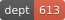
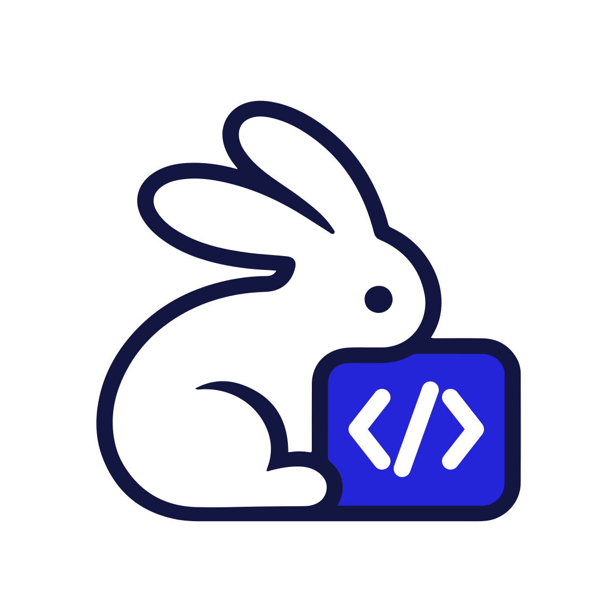

# Lièvre

[](https://github.com/shiroinock/lievre/blob/dept-badge/dept.md)



日本語の画面を読みやすく組み立てるためのデザインシステムです。作者個人の実験的なデザインシステムで、特定の用途に絞らず、質感や経年のような表現も試しています。どの試みでも、WCAG 2.x AA などの Web 標準の基準は守ります。設計の考え方は [DESIGN.md](DESIGN.md) にまとめています。

このリポジトリは npm のワークスペースで、同じデザイン言語のパッケージを3つ持っています。

| パッケージ                          | 場所              | 内容                                                                     |
| ----------------------------------- | ----------------- | ------------------------------------------------------------------------ |
| [`@lievre/tokens`](packages/tokens) | `packages/tokens` | トークンの正（`tokens.css`）と、そこから書き出す交換用の `tokens.json`   |
| [`@lievre/react`](packages/react)   | `packages/react`  | React の部品、`styles.css`、利用者向けの lint、`llms.txt`                |
| [`@lievre/tui`](packages/tui)       | `packages/tui`    | 端末（TUI）の部品。Ink 8 で描く。色と字の組を決める中核は Ink に依らない |

名前を lievre に改めました（読みはフランス語の lièvre、野うさぎ）。改名の前の名前から移る手順は [MIGRATION.md](MIGRATION.md) にあります。

使い方（別のプロジェクトへの取り込み、lint の設定）は [packages/react/README.md](packages/react/README.md) にあります。AI のコーディングエージェントで使うときは、まず [llms.txt](packages/react/llms.txt) を読ませてください。

## 起動

Node.js 24.15 以降が必要です。コマンドはすべてリポジトリの直下で実行します。

```sh
npm ci
npm run storybook   # http://127.0.0.1:6006
npm run dev         # 概要のデモ http://127.0.0.1:5173
```

`.npmrc` の `legacy-peer-deps=true` は、npm が optional peer を解決するときに出る `edgesOut` エラーを避けるための設定です。

### Nix で使う

Nix（flakes を有効にしたもの）があれば、Node.js などを別に入れなくても始められます。nixpkgs は `nixpkgs-unstable` を `flake.lock` で固定しています。対応する system は `aarch64-darwin`・`x86_64-linux`・`aarch64-linux` です（x86_64-darwin は nixpkgs 26.11 でサポートが終わったので外しています）。

```sh
nix develop         # Node.js 24、npm、Chromium（Playwright 用）、fontTools と brotli 入りの Python
npm ci
```

`nix develop` の中では、`npm run test:layout` は nixpkgs の Chromium（headless shell）を使うので、`npx playwright install` は要りません。経年の書体を焼く Python も用意されるので、`npm run wear:setup` も要りません。`.envrc` に `use flake` を書いてあるので、direnv を入れれば、フォルダに入ったときに自動で同じ環境になります。

ビルドと `lievre-migrate`（[MIGRATION.md](MIGRATION.md)）は、手元に clone しなくても動かせます。`lievre-migrate` は引数のフォルダ（省くと今のフォルダ）を書き換えるので、先に `--dry-run` で確かめてください。

```sh
nix run github:shiroinock/lievre -- --dry-run src   # 直す予定のファイルを並べる
nix run github:shiroinock/lievre -- src             # 書き換える
nix build github:shiroinock/lievre                  # result/lib/node_modules/@lievre/{tokens,react,tui}
nix build .#storybook                               # result/ に Storybook（.#demo は概要のデモ）
nix fmt                                             # flake.nix を整える
```

Nix は npm の依存を `package-lock.json` の `integrity` で取ってくるので（`importNpmLock`）、`package-lock.json` を変えても `flake.nix` を直す必要はありません。Nix で取ってこられない依存が入った PR は、CI の「Nix のハッシュ」が止めます。

## 構成

| 場所                            | 内容                                                               |
| ------------------------------- | ------------------------------------------------------------------ |
| `packages/tokens/tokens.css`    | トークン（トークンの正）                                           |
| `packages/tokens/tokens.json`   | `tokens.css` から生成した交換用のトークン                          |
| `packages/react/src/components` | React コンポーネントと型                                           |
| `packages/react/src/styles`     | 部品のスタイル（`lievre.css`）。トークンの層は tokens から読み込む |
| `packages/react/src/stories`    | 各部品の Story（Controls・Autodocs・Accessibility・play 関数）     |
| `packages/react/src/docs`       | 導入、設計原則、配色・文字・余白                                   |
| `packages/react/src/patterns`   | 画面例：探す・読む・申し込む・管理する                             |
| `packages/react/llms.txt`       | エージェント向けの使い方と全部品の API（型から生成）               |
| `packages/react/lint`           | 使う側のアプリ向けの lint ルール（ESLint・Oxlint・Biome）          |
| `packages/react/bench/agent`    | エージェント向けのベンチマーク                                     |
| `packages/tui/src`              | 端末の部品（`core` と `ink`）                                      |
| `references`                    | 参考にした81件のピンと一覧ビューア                                 |
| `docs`                          | 設計の判断と比較の記録                                             |
| `spikes`                        | 試作（ワークスペースに入れない）                                   |

## 開発

```sh
npm run typecheck   # 各パッケージの tsc
npm run lint        # stylelint の lievre 独自ルール（packages/react/scripts/stylelint-lievre.mjs）と、使う側向けのルール（lint/）を Story と画面例に
npm test            # tokens の同期、react の部品・画面フロー・axe・コントラスト、tui の描画とコントラスト
npm run test:layout # 配置の基準をブラウザで測る（docs/quality-gate.md、初回は npx playwright install chromium）
npm run tokens      # tokens.css を変更したら tokens.json を書き出す
npm run llms        # 部品の props や説明を変えたら llms.txt を書き出す
npm run bench:agent # エージェント向けのベンチマーク（docs/agent-benchmark.md）
npm run format
npm run build       # react の lib/・dist/・dist/storybook/ と tui の lib/
```

1つのパッケージだけで流すときは、`npm test -w packages/tui` のように `-w` を付けます。

質感の試作（[references/wear-prototype.md](references/wear-prototype.md)）の強さを調整するときは、はじめに一度だけ `npm run wear:setup` を実行します（`nix develop` の中では要りません）。`packages/react/.venv-wear/` に、フォントを焼くための fontTools と brotli を入れます。

```sh
npm run wear:setup  # .venv-wear/ を作る（uv があれば uv、なければ python3 -m venv と pip）
npm run wear:tune   # 調整の画面を開く
npm run wear:font   # wear.config.json の値でフォントを焼く
```

部品を追加するときの手順は [CONTRIBUTING.md](CONTRIBUTING.md) にあります。

jsdom では色のコントラストを測れないため、トークンの組み合わせを数値で検査するテストを別に用意しています。

## 公開の手順

まだ npm には公開していません（どのパッケージも `private: true`）。公開するときは次の順にします。依存を増やさないため、changesets などの道具は入れません。

1. 公開するパッケージの `private: true` を外す。`@lievre/react` は `styles.css` と `tokens.json` にトークンを焼き込んでいるので、`@lievre/tokens` を入れなくても使える。`@lievre/tui` は `@lievre/tokens` に依存するので、tokens も一緒に公開する。
2. 3つの版を揃えて上げる：`npm version <版> -w packages/tokens -w packages/react -w packages/tui`。`packages/react/lint/index.js` の `meta.version` も同じ値にする（テストが止める）。
3. 中身を確かめる：`npm run build`、`npm run check:pack -w packages/react`。`npm pack -w packages/react` で作った物を、別のプロジェクトに入れて試す。
4. 公開する：`npm publish -w packages/tokens -w packages/react -w packages/tui --access public`。

`DESIGN.md` はリポジトリの直下にあり、`@lievre/react` の `prepack` がパッケージへ写し、`postpack` が消します。

## ロゴ

ロゴは [logo](logo) にあります。うさぎと窓の外形は共通で、窓の中身と使う場面で分けています。

| ファイル                                                      | 使う場面                                                                                 |
| ------------------------------------------------------------- | ---------------------------------------------------------------------------------------- |
| [`lievre-web.svg`](logo/lievre-web.svg)                       | Web 向けのパッケージ。窓の中身は `</>`                                                   |
| [`lievre-tui.svg`](logo/lievre-tui.svg)                       | TUI 向けのパッケージ。窓の中身は `>_`                                                    |
| [`lievre-web-small.svg`](logo/lievre-web-small.svg)           | 24px 以下とファビコン。線を太くし、窓の中身は `<>`                                       |
| [`lievre-web-tile-light.svg`](logo/lievre-web-tile-light.svg) | README の先頭。明るい版を白い下地に載せた画像で、GitHub のテーマにかかわらず同じに見える |

窓の塗りは強調色の `--lv-accent` と同じ色で、線と字形の色もトークンの値に合わせています。色は `prefers-color-scheme` で明暗が切り替わります。この切り替えは OS の設定に従い、GitHub のテーマには従いません。そのため README では、白い下地ごと色を固定した画像を使っています。トークンの色を変えたら、ロゴの色も合わせて、窓と字形のコントラストが AA を満たすことを確かめてください。
