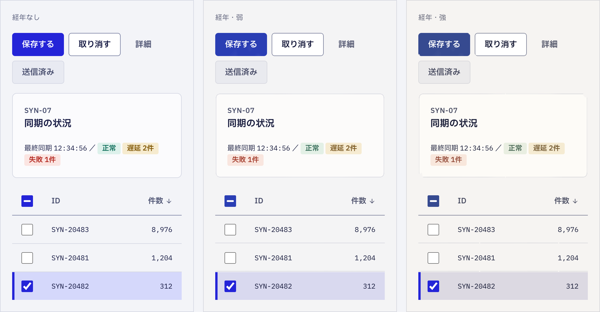
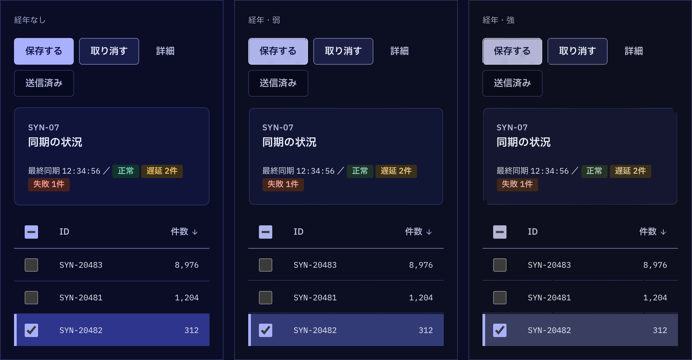

# 試作：経年（age）

刷ってから時間がたった紙の印刷物の見え方を、テーマ・表示密度・書体と並ぶ独立した軸として足す試作です。質感（[wear](wear-prototype.md)）とは別に効き、組み合わせられます。採用は未定です。



## 使い方

```tsx
<KeiProvider age="light">…</KeiProvider>   // none（既定）・light・heavy
<KeiProvider age="heavy">
  <KeiProvider age="none">ここだけ新しい</KeiProvider>
</KeiProvider>
```

- `age` は入れ子にでき、指定がなければ外側の値を受け継ぎます。ポータル（Dialog など）にも `data-age` が渡ります。
- 既定は `none`。強いコントラストを求める設定（`prefers-contrast: more`）と強制カラーモード（`forced-colors: active`）では、指定にかかわらず `none` になります。生成する CSS も、同じ条件のメディアクエリの内側にあります。
- 強さは [wear.config.json](../wear.config.json) の `age` に保存し、調整画面（`npm run wear:tune`）の「経年を見比べる」で、Button・Card・DataTable を経年なし・弱・強で並べて確かめます。弱は強の半分です。

## 5つの素材

部品ごとに汚すのではなく、5つの素材をトークンとクラスで用意し、部品はそれを受け取ります。

| 素材 | 何をするか | 部品への渡し方 |
| --- | --- | --- |
| 褪色（fade） | 色のトークンを全て、OKLab で同じ明るさのまま黄みの灰へ寄せる。強調・状態の色、その淡い地（`-soft`・`selected`・`skeleton`）、アプリの枠（`frame*`）は量の 1 倍、地・面・線・文字（`bg`・`surface*`・`border*`・`text`・`muted`・`subtle`・`on-*`・枠の上の色）は 0.5 倍。半透明の `overlay` だけは下の色を暗くするものなので褪せない | トークンの値を差し替える（`--k-accent` など）。全ての部品・アイコン・ポータルに効く |
| 版ズレ（shift） | 塗りの面が輪郭から 0.5〜1px（強・標準）ずれたように見せる。内側の影で描くので、大きさも位置も変わらない | `.k-button--primary`・`.k-button--danger`・`.k-age-fill`。バッジ（`.k-badge`・`.k-age-print`）は 0.7 倍 |
| インクのむら（mottle） | 塗りの面に紙の色がまだらに透ける | `.k-age-fill` と同じ。画像はテーマと強さごと |
| 罫線のかすれ（rules） | 1px の線が長さに沿って濃くなったり薄くなったりし、ごくまれに 1〜3px 途切れる | カードの輪郭（`.k-card`・`.k-age-sheet`）と表の行の罫線（`.k-table` の行・`.k-age-rule`） |
| 角の欠け（chips） | 角が1〜2か所、小さく欠ける | カード（強）、ボタン（`.k-button`・`.k-age-corner`、0.35 倍） |

`.k-age-*` のクラスは、ほかの部品やアプリの部品が同じ素材を受け取るためのものです。

### 場所による強さ

[age.mjs の AGE_PLACES](../src/wear/age.mjs) に、場所ごとの倍率を置いています。カードは罫線のかすれも角の欠けも 1 倍、表の罫線は 0.5 倍（13〜14px の行が読みにくくならないよう）、ボタンの角は 0.35 倍、入力欄には何もかけません。褪色だけはトークンなので、見出しも Meter もサイドバーも含めて全体に同じだけ効きます。トークンを通らない色が部品やデモに残ると、そこだけ褪せずに浮くので、stylelint の `kei/colour-tokens` が `kei.tokens` の外の色の値（`#…`・`rgb()`・`oklch()`・色の名前）を止め、TSX のインラインの色はテストが止めます（透明度だけを使うマスクの `#000` と、トークンから計算して作る `src/styles/wear/` は例外）。

### 罫線のかすれ

最初の試作は、線を一定の長さの区間ごとに切っていました。1px の線では、それが「ただの破線」に見えました。今は次のようにしています（[age.mjs の ruleStops](../src/wear/age.mjs)）。

- **濃さのむらが主**：2つの大きさの滑らかなノイズで、線の濃さを長さに沿って変えます（強・標準のカードで 1〜0.55、表で 1〜0.69 程度）。区間の境目もグラデーションでつなぐので、段は付きません。
- **途切れは稀**：区間ごとに `rules × 0.08` の確率で、1〜3px だけ切れます。720px の繰り返しの中で 0〜3 か所ほどです。
- **規則的に見せない**：区間の長さは 6〜46px の偏った乱数で、繰り返しの周期は 720px（たいていの線より長い）。ノイズも周期で継ぎ目なくつながります。

表の行の罫線は、選択した行の左端の線と同じ背景に描くので、選択した行では両方を重ねて描きます（以前は罫線が左端の線を消していました）。

### 試作の範囲

今回は Button（primary / secondary / ghost / 無効）、Card、DataTable（選択した行、ホバー、並べ替えの見出し）で試しました。CSS は [src/styles/wear/age.css](../src/styles/wear/age.css) に生成し、[kei-wear.css](../src/styles/kei-wear.css) から読み込みます。kei.css の Button・Card・表の規則には手を入れていません。

## 状態は経年の外に置く

- **フォーカス**：`--k-focus` は褪せる前の `accent` に固定します。マスクはフォーカスの枠も切ってしまうので、フォーカスしているボタン（`:focus-visible`）と、中にフォーカスがあるカード（`:focus-within`）には角の欠けをかけません。
- **選択・状態の印**：次の要素の中では、強調と状態の色（`accent`・`accent-hover`・`success`・`warning`・`danger`・`info`）を褪せる前の値に戻します（`AGE_STATES`）。選択した行の左端の線とそのチェック（`tr[data-selected] > :first-child`）、選んでいるタブの線（`[role='tab'][data-state='active']`）、エラー（`aria-invalid`・`.k-field-error`・`[data-tone='error']`）。行全体・チェック全般・現在地・並べ替えの見出しは、以前は戻していましたが、それでは画面のあちこちに褪せない色が残ったので、印そのものだけにしました。選択の面（`selected`）は褪せても、面と 1.3:1 以上の差を保ちます。
- **無効**：版ズレ・むら・角の欠けは `:not(:disabled)` にしかかけません。無効のボタンは沈んだ面（`surface-sunken`）に補助の文字色（`muted`）で、どちらも地・文字として半分だけ褪せるので、ほとんど見た目が変わりません。
- **色だけで示さない**：経年は状態の印（チェック、選択した行の帯、並べ替えの矢印、エラーの文言）を消したり形を変えたりしません。
- **動きを減らす設定**：経年は動きを持ちません（画像とグラデーションだけで、アニメーションはありません）。

### 無効と経年の差

経年・強（全ての素材を最大）の primary と、無効のボタンの差です（テストで確かめています）。

| テーマ | 塗りの色の差（OKLab ΔE） | 2つの塗りのコントラスト | 経年の primary の文字 | 無効の文字 |
| --- | --- | --- | --- | --- |
| Paper | 0.51 | 6.81:1 | 8.18:1 | 6.54:1 |
| Ink | 0.63 | 9.88:1 | 8.84:1 | 10.21:1 |

ΔE はおよそ 0.02 で見分けられる差です。褪せても、無効の灰とは明らかに別の色のままです。

## WCAG 2.x AA を守るしくみ

どのプリセット、どのスライダーの値でも、次を満たします。

- **褪色は、割る手前で止まる**：全てのトークンに1つの量をかけ、求めた量から 0.05 刻みで下げて、次の組が全て保てる量にします（もとから下回っていた組では、もとの値より下がらないこと）。文字（`text`・`muted`・`subtle`・状態の色・`accent`）を4つの面と汚れ・ヤケ・擦れの最も濃い紙の上に置いたとき 4.5:1、状態の色の文字を薄い地（`-soft`）の上で 4.5:1、塗りの上の文字（`on-accent`・`on-danger`）4.5:1、選択した行の文字 4.5:1、操作の輪郭（`border-strong`）3:1、フォーカスと褪せない状態の印を褪せた面の上で 3:1・4.5:1、選択の面と面・地・凹んだ面の差 1.3・1.25・1.15、アプリの枠の文字 4.5:1 と選択中の項目・フォーカス 3:1。標準の値では、強でも求めた量（0.8）まで褪せます。
- **むらは、割る手前で頭打ち**：塗りに紙の色が最も多く透けた点でも、上の文字が 4.5:1 を保つ濃さで止めます（標準の値で 0.16〜0.33）。
- **フォーカスは褪せない**：褪せる前の `accent` のまま、全ての面の上で 3:1 以上です。
- **操作の輪郭は 3:1 を保つ**：secondary の輪郭（`border-strong`）は線として半分だけ褪せ、面に対して 3:1 以上を保ちます（質感の焼き込みが輪郭を濃くしているときは、そちらが勝ちます）。primary の塗りは褪せても背景に対して 4.5:1 以上あるので、ボタンの形は 3:1 以上で見えます。
- **保存の検査**：調整画面の保存は、`ageContrast`（上の組のどれか、文字 4.5:1、輪郭とフォーカス 3:1）を割る値と、スライダーの範囲の外の値を受け付けません（[tune-server.mjs](../scripts/wear/tune-server.mjs) の `validate`）。

標準の値・強の、褪色したあとの accent：Paper `#2424d8` → `#364a90`、Ink `#a9b1ff` → `#b4b5d5`。

## 設定

```json
"age": { "fade": 0.8, "shift": 1, "mottle": 0.35, "rules": 0.6, "chips": 0.6 }
```

| 値 | 範囲 | 意味 |
| --- | --- | --- |
| `fade` | 0〜1 | 強での褪色の量（1 で OKLab 上 60% 黄みの灰へ）。コントラストで止まる |
| `shift` | 0〜1.5 | 強での版ズレ（px の目安。実際は 0.5〜1 倍の乱数） |
| `mottle` | 0〜1 | 強でのむらの最大の不透明度。コントラストで頭打ち |
| `rules` | 0〜1 | 罫線の濃さのむら（1 で最も薄いところが 0.25）と、途切れの頻度（1 で区間の 8%） |
| `chips` | 0〜1 | 角の欠けの大きさ（1 で 32px 四方の中の欠け） |

プリセット：控えめ `{0.5, 0.8, 0.25, 0.4, 0.4}`、標準 `{0.8, 1, 0.35, 0.6, 0.6}`、強め `{1, 1.5, 0.5, 1, 1}`。

ずれの向き、むらの位置、欠ける角、罫線の切れ目は、ソルトから決まり、部品ごとに4通り（`:nth-of-type`）に散らします。

## 生成物

- `src/styles/wear/age.css`：強さごとの形（版ズレ・欠け・かすれ）の変数、テーマと強さごとの褪色した色、規則（57KB。罫線の周期を 720px に延ばし、全ての色のトークンを出すので増えました）。
- `age-mottle-{theme}-{light|heavy}.png`：128px 四方を 256px に広げて使う（8枚、各3KB）。`age-chip-{tl,tr,br,bl}.png`：32px 四方（4枚、各0.2KB）。
- 調整画面は、自分の値を渡した KeiProvider で、同じ変数と画像をその場で作って当てます（[live.tsx の liveAgeStyle](../src/wear/live.tsx)）。

## テスト

[src/test/age.test.tsx](../src/test/age.test.tsx) と [age-validate.test.tsx](../src/test/age-validate.test.tsx)：

- 全てのプリセットと、全てのスライダーを最大にした値で、褪色した全ての組が 4.5:1、フォーカスが 3:1 以上。
- 褪色は求めた量を超えず、色のあるトークンの彩度を増やさない。青は紫を通らず灰青へ褪せる。kei.css の色のトークンは `overlay` と `focus` を除いて全て褪色の対象に入っている。
- 罫線は濃さが 0.15 以上変わり、途切れは周期の中で 6 か所以下、区間の長さは1つの値に偏らない。
- むらは 0 より大きく、設定の値以下。
- フォーカスと状態の印が褪せる前の色を使う。選択した行の左端の線が、表の罫線と重ねて描かれる。age.css に `:focus` の装飾がない。ボタンへの規則は全て `:not(:disabled…)`。
- 無効と経年の primary の差（上の表）。
- age.css が wear.config.json から作り直したものと一致する。age.css の宣言は色・マスク・影・背景の画像だけで、箱の大きさと位置を変えない。
- 既定は none、入れ子で受け継ぐ、強いコントラストと強制カラーで none。
- 調整画面の保存の検査が、全てのプリセットと最大の値を通し、範囲の外を断る。

## 画像

| | |
| --- | --- |
|  |  |
