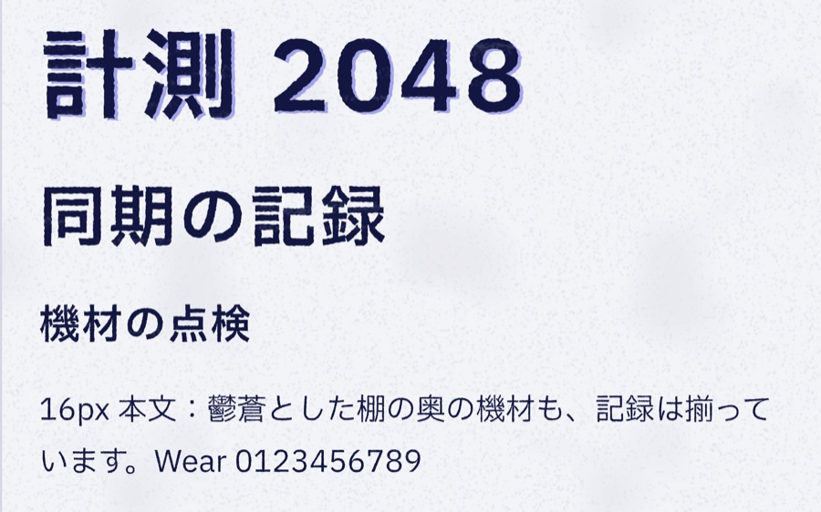
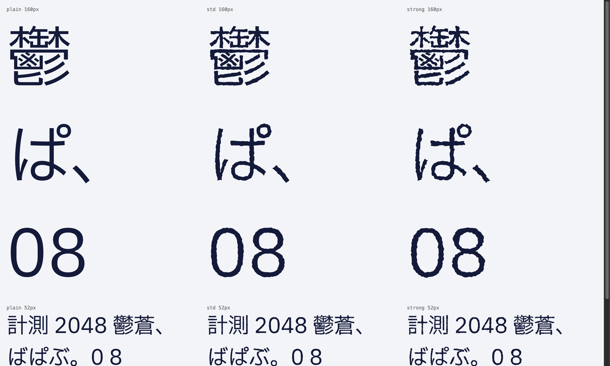

# 試作：シードで固定できる質感（off / baked / live）

カスレ・縁の荒れ・汚れで物質感を足しつつ、性能を優先して切れるようにする試作です。採用は未定です。見比べる場所は Storybook の「Foundations / 試作 配色と擦れ」と、demo アプリのサイドバーの「質感（試作）」です。強さは、手元の調整画面（`npm run wear:tune`）で決めて [wear.config.json](../wear.config.json) に保存します（[下の「強さの調整」](#強さの調整)）。

## 使い方

```tsx
<KeiProvider wear="baked">…</KeiProvider>
<KeiProvider wear="live" wearSeed="ash">…</KeiProvider>
```

| 段階    | 何をするか                                                                                                         | ブラウザでの計算                         |
| ------- | ------------------------------------------------------------------------------------------------------------------ | ---------------------------------------- |
| `off`   | 質感なし（既定）                                                                                                   | なし                                     |
| `baked` | ビルド時にソルトから焼いた画像（粒と汚れ、文字のカスレ）を貼る。`npm run wear:font` を実行していれば字の縁も荒らす | 背景画像とマスク画像を貼るだけ           |
| `live`  | baked と同じ画像をブラウザで作って貼り、字の縁の荒れの代わりに、細かいノイズの `feDisplacementMap` で縁を揺らす                 | SVG フィルタ（要素ごとに描くたびに計算） |

前の試作の `clean / worn` は、`off / baked` に置き換えました。強さは `wear.config.json` で決めます。live だけは `wearConfig` で上書きでき、調整画面がこれを使います。

次の場合は、`KeiProvider` が段階を自動で下げます。JavaScript がないときのために、CSS のメディアクエリでも同じように切ります。

- `prefers-contrast: more` または強制カラーモード：`off`
- `prefers-reduced-motion: reduce`：`live` を `baked` に下げる

## シード

- `hash(ソルト + 部品の種類 + 位置)` で部品ごとの値を決めます（FNV-1a、[src/wear/seed.mjs](../src/wear/seed.mjs)）。続けて値を取り出すときは mulberry32 を使います。同じソルトなら毎回同じ見た目になります。
- 部品の種類は `root`（作業面）、`card` と、文字の種類 `small`（12–13px）、`text`（本文）、`heading`、`figure`（Metric・Meter の数値）、`data`（表のセル）です。位置は `:nth-of-type(4n+1〜4)` の4種類で、同じ種類の部品が並んでも模様の位置がずれます。
- ソルトは `wear.config.json` の `salt` で決まります。live の `wearSeed` の既定もこの値なので、何も指定しなければ live と baked は同じ模様になります。
- フォントの変形（[scripts/wear/font.py](../scripts/wear/font.py)）でも同じハッシュとノイズを Python で使います。JavaScript と同じ値を返すことを確かめています（負の座標も含む）。

## baked

- `npm run wear`：[scripts/build-wear.mjs](../scripts/build-wear.mjs) が、[src/styles/wear/](../src/styles/wear/) に次のものを書き出します。依存するのは Node の zlib だけです。`npm run build` に組み込みました。
  - 粒と汚れ：256px 四方のタイルを、テーマごとに4枚（各16KB）。文字色を、最も濃い点でも `stain.strength`（標準 0.08）まで重ねます。
  - 文字のカスレ：マスク画像1枚（5KB）。最も薄い点でも `kasure.floor`（標準 0.8）を残します。文字の種類ごとの深さは、マスクの上に平らな層を重ねて浅くします（深さ f のとき、最も薄い点は 1 − (1 − floor) × f）。
  - `baked.css`：設定から決まる値。模様の位置、刷りのずれの量、罫線の欠け方、文字の種類ごとのカスレの深さ、縁を荒らす種類に使う worn フォント。
  - `rules.css`：文字の種類（`TEXT_KINDS`）から決まる規則。どの要素にカスレとフィルタをかけるか。baked と live で共通です。
  - `wear.json`：設定と、画素のハッシュ。テストで、`wear.config.json` から生成し直した結果と一致するかを調べます。
- WebP ではなく PNG（16階調のパレット）にしました。WebP を書き出すには外部の部品が必要で、PNG でも十分に小さいためです。
- `npm run wear:font`：Plex Sans JP（400 / 500 / 600）と、KEI Mono の元になっている Plex Mono の英数字（latin、400 / 500 / 600）の、全ての字形を変形します。
  - 字の形（骨格）は動かさず、縁だけを荒らします（[scripts/wear/font.py](../scripts/wear/font.py)）。
    1. 輪郭の曲線と直線を、`outline.step`（標準 12/1000em）ほどの長さの短い区間に分けます。
    2. 縁の荒れ：分けた点を、輪郭の法線の向きにだけ動かします。ノイズの波長は `outline.roughScale`（標準 26/1000em）と短く、量は `outline.rough`（標準 7/1000em）です。
    3. 太さのむら：波長の長い（`outline.swellScale`、標準 220/1000em）ノイズで、法線の向きに少しふくらませたり細らせたりします。量は `outline.swell`（標準 4/1000em）です。
    4. 動く量の上限を、いちばん細い画の太さに対して決めます。縁の荒れは 20%、太さのむらは 12%、合わせて 25% までです。細い画の太さは、Sans JP の「一」「三」などで測った値（400 で 66、600 で 113）をもとに、ウェイトごとに 60 / 85 / 100（Mono は 70 / 90 / 105）としました。濁点や句読点のように小さい輪郭は、大きさに合わせて動く量をさらに減らします。細い横画、濁点、句読点、0 や 8 の穴がつぶれたり消えたりしないようにするためです。
    - 点は `hash(ソルト + "glyph" + 字形名)` で決まるノイズで動かします。ヒンティングは外します。
  - Sans JP と Mono には、同じソルトで、同じ強さの荒れをかけます。言葉と数値で、擦れ方がそろって見えるようにするためです。KEI Worn Mono にも、KEI Mono と同じ `size-adjust: 83.333%` と unicode-range を付けます。
  - 動かすのは字の輪郭だけで、送り幅（advance width）は変えません。英数字と日本語の幅が 1:2 になることと、表の桁がそろうことを保つためです。左の余白（lsb）は、動かした後の輪郭の左端に合わせ直します。合わせ直さないと、描画のときに字の原点がずれるためです。
  - `npm run wear:font` は、生成のたびに（キャッシュを使ったときも）、全てのファイルの全ての字形について、送り幅（横書きの hmtx と、あれば縦書きの vmtx）と字形の並びが元のフォントと一致するかを調べます。一致しなければ止まります。今のソルトでは、372ファイル・60,510字形が一致しました。わざと1字の幅を変えたファイルでは、検査が止まることも確かめました。
  - @fontsource と同じ unicode-range の区切り（ウェイトごとに123ファイル）のまま書き出します。ページは使う区切りだけを読み込みます。実際に使う文字だけに絞る方式は使っていません。
  - 字形の左の余白（lsb）が、動かした後の輪郭の左端と一致することも調べます。
  - 結果は、ソルト・`outline` の値・生成方法の版ごとに `wear-fonts/<ハッシュ>/` へキャッシュします（git の管理外）。3ウェイトで372ファイル・19.4MB（前の歪ませる方式では 5.0MB）、8コアで生成に65〜110秒かかりました。輪郭を細かく分けて点が増えるためです。`step` を長くすると軽くなります。2回目以降はキャッシュを使います。
  - Python 3 と fontTools・brotli が必要なので、`npm run build` には入れていません。入っていない環境では、`'KEI Worn Sans'` が見つからず、普通の Plex で表示されます。worn フォントを使うのは、設定で「縁の荒れ」を入れた文字の種類（`distort`）だけです。

## live

- 粒と汚れ、カスレ、模様の位置は、baked と同じ関数（[src/wear/textures.mjs](../src/wear/textures.mjs)）でブラウザの中で作ります。画像は圧縮せずに PNG にし、blob URL で渡します。画素は baked と同じです（テストで確かめています）。
- 縁の荒れは、荒らす文字の種類と位置ごとに SVG フィルタを作ります（標準では3種類×4で12個）。`feTurbulence`（seed 属性）と `feDisplacementMap` を使います（`liveEdge`）。細かさは `outline.roughScale` から、大きさは縁の荒れと太さのむらを合わせた量から、文字の種類ごとの代表の大きさで換算します。
- これは近似です。フィルタは画素を横と縦にずらすので、縁の法線の向きだけに動かすことはできず、字の内側も少し揺れます。太さのむらも表せません。調整の画面にも、この違いを書いています。
- フィルタは、本文や見出しなど文字の要素だけにかけます。部品の箱にはかけません。

## 強さの調整

`npm run wear:tune` で、手元の開発サーバーに調整の画面（`tune.html`）を開きます。

- スライダーで変えられる値：縁の荒れの量と細かさ、太さのむらの量と広さ、輪郭を分ける長さ、カスレの密度・しきい値・最も薄い点、汚れの濃さ、ソルト。文字の種類ごとに、縁を荒らすかどうかと、カスレの深さも変えられます。
- 変えた値は「実行時（live）」の列にすぐ反映します。隣に「質感なし」「焼き込み（保存した値）」と「焼き込みの試し（今の値）」を並べます。「焼き込みの試し」は、開発サーバーが見本の文字に使う区切りだけを今の値で焼いて（約2秒）返すもので、保存しなくても焼き込みの見た目を確かめられます。見本は、12 / 14 / 16px の本文と見出し、KEI Mono の数値・ID・時刻、表、ボタン、入力欄、Metric、Meter です。テーマは4つから選べます。
- 読みやすさの目安を数値で出します（[src/wear/gauges.mjs](../src/wear/gauges.mjs)）。
  - 縁の動き（px、上限で切った後の値）と、いちばん細い画（60/1000em）に対する割合。目安は20%まで、30%を超えると「超過」です。14px 未満の文字の縁を荒らすと「注意」にします。
  - カスレで5%以上薄くなる画素の割合。目安は15%まで、30%を超えると「超過」です。
  - 最も濃い汚れの上の、全ての文字色と、最も薄いカスレの文字のコントラスト。4.5:1 未満なら「超過」です。
- 小さい文字ほど控えめにする仕組みとして、文字の種類（`small` / `text` / `heading` / `figure` / `data`）ごとに、縁を荒らすかとカスレの深さを分けました。CSS では計算後の文字の大きさで要素を選べないので、型の段階（`k-text--small` など）で分けています。縁の動きは em 単位なので、px では小さい文字ほど少なく動きます。
- 「保存して焼き込む」で、開発サーバーが `wear.config.json` を書き、`src/styles/wear/` を生成し直し、フォントの焼き込み（`npm run wear:font`）を始めます。この窓口は `vite` の開発サーバーにしかなく、同じ機械からの、同じオリジンのページからの要求だけを受け付けます。コントラストが 4.5:1 に届かない値は保存しません。
- プリセットは3つです（[src/wear/presets.mjs](../src/wear/presets.mjs)）。

| プリセット | 縁（荒れ / 細かさ / むら / 広さ / 区間） | カスレ（密度 / しきい値 / 最も薄い点） | 汚れ | 荒らす種類 | 目安 |
| --- | --- | --- | --- | --- | --- |
| 控えめ | 4 / 24 / 2 / 240 / 14 | 4 / 0.70 / 0.86 | 0.05 | 見出し・数値 | すべて目安内 |
| 標準（既定） | 7 / 26 / 4 / 220 / 12 | 6 / 0.64 / 0.80 | 0.08 | 本文・見出し・数値 | すべて目安内（テストで確かめる） |
| 強め | 11 / 28 / 6 / 180 / 10 | 8 / 0.56 / 0.72 | 0.10 | 本文・見出し・数値・表 | 縁の動きとカスレが「注意」 |

### 縁を荒らす方式（前の方式との違い）

前の方式は、字形の点を波長 140/1000em ほどの滑らかなノイズで動かしていたため、字の形そのものがゆがみました。今の方式は骨格を動かさず、縁だけを細かく荒らします。本文の大きさでは縁の動きは 1px に届かないので、見た目はほとんど変わりません。見出しの大きさで、刷りの縁のざらつきとして見えます。

| 前（字形をゆがませる） | 後（縁だけを荒らす） |
| --- | --- |
|  |  |

160px に拡大した字（標準・強め）。細い横画、濁点・半濁点、句読点、0 と 8 の穴が残ることを確かめました。



### 設定と生成物の同期

- `npm run wear`（`npm run build` に含む）は `wear.config.json` から画像と CSS を作ります。テストは、設定から生成し直した結果と、コミットされた `src/styles/wear/` が一致するかを調べます。設定だけ変えて生成し直していなければ、テストが失敗します。
- worn フォントは git の管理外なので、`npm run wear:font` が `wear-fonts/current.json` に、焼いたときの値を書きます。このファイルがある環境では、テストが設定と一致するかを調べます。

### フォントの位置の確かめ方

調整の画面の「焼き込んだフォントの位置」で、普通の字と焼き込んだ字を 0.5em の目盛りの上に並べます。同時に、ブラウザで次のことを測ります（結果は `window.__keiWearFontCheck` にも置きます）。

- 6種類の文字列 × 3ウェイト × 2書体で、幅の差が 0.01px 未満であること。
- KEI Worn Mono で、かな1字の幅が英字1字のちょうど2倍であること。
- 英数字36字の左の端が、平均でも最大でも、縁の動きの範囲でしか動かないこと（原点がずれていれば、全ての字が同じ向きにずれます）。

標準の値では、幅の差は 0.000px、比は 2.000、左の端の動きは平均 −0.13px・最大 0.43px（64px のとき、許容 1.59px）でした。

## 日本語への適用

- カスレと汚れはマスクと背景で付けるので、字の種類によらず、かなにも漢字にも英数字にも同じようにかかります。
- 縁の荒れは、live ではフィルタがそのまま日本語にもかかります。baked では、@fontsource が持つ全ての区切りの全字形の縁を荒らしています。画の多い漢字でも細い画が消えないように、動く量を細い画の太さで抑えています。

## ライセンス

- IBM Plex は SIL Open Font License 1.1 で、「Plex」は予約されたフォント名（Reserved Font Name）です。[IBM/plex の LICENSE.txt](https://github.com/IBM/plex/blob/master/LICENSE.txt) の冒頭に「Copyright © 2017 IBM Corp. with Reserved Font Name "Plex"」とあることを確かめました（@fontsource が同梱している LICENSE にはこの一文がありません）。
- そのため、変形したフォントは **KEI Worn Sans** と **KEI Worn Mono** という名前にしました。name テーブルからは、著作権表示（nameID 0）を除いて「Plex」を消しています。生成したフォルダには、変更点を書き添えた OFL の全文（`LICENSE.txt`）を置きます。OFL では、フォントだけを単体で販売することはできません。

## 守っていること

- フォーカスの枠、入力やボタンなどの操作部、状態の色や記号には、質感をかけません。リンクや操作部を含む要素にも、マスクやフィルタをかけません。テストで、`kei-wear.css` がそれらのセレクタを含まないことを調べています。
- 補助文字（`k-muted`）には、カスレをかけません。最も濃い点のコントラストに余裕がないためです。
- 部品の大きさや位置は変えません。`kei-wear.css` が使ってよいプロパティをテストで限っています。Chrome でも、demo の2画面（565要素）で、off・baked・live の間で箱が1つも動かないことを確かめました（回転し続ける読み込み中のアイコン2つは除く）。
- コントラストは、最も濃い点で検査しています（[src/test/contrast.test.tsx](../src/test/contrast.test.tsx)）。
  - 汚れが最も濃い点で、全ての文字色が4.5:1以上になること。
  - その上でカスレが最も薄い点の文字でも、4.5:1以上になること。
  - 当初の下限 0.62 では Paper と Sepia が届かなかったので、0.72 に上げました。

## 性能の計測

> 以下は、強さを調整できるようにする前の値（大きさ 28 / 波長 110、live のカスレと汚れも SVG フィルタで描いていたとき）で測ったものです。今の live は、カスレと汚れを画像で貼り、フィルタは縁の荒れだけなので、これより軽くなるはずですが、測り直してはいません。

Chrome（chrome-devtools MCP で起動したもの）で、demo アプリを `vite build` してから測りました。条件は Sepia テーマ、1280×800 です。

1. 30px ずつ300フレームかけてスクロールして、戻す。
2. ホバーの代わりに、ボタンとカードの色を120フレームのあいだ毎フレーム切り替える。
3. 1と2を、CPU を4倍遅くした状態で、性能トレースを取りながら行い、描画にかかった時間の合計を集計する。

### フレーム間隔（requestAnimationFrame）

どの段階でも、95パーセンタイルは 17.5〜18.2ms でした。CPU を6倍遅くしても変わりません。この方法ではラスタや GPU の処理が見えないので、トレースでも測りました。

### 描画にかかった時間の合計（CPU 4倍遅く、ms）

| 画面                           | 段階  | Paint | Raster | GPU                                    |
| ------------------------------ | ----- | ----: | -----: | -------------------------------------- |
| はじめに（フィルタのかかる要素 7個）   | off   |   177 |     28 | 48                                     |
|                                | baked |   350 |     63 | 112                                    |
|                                | live  |   387 |     69 | 195                                    |
| コンポーネント（フィルタのかかる要素 23個） | off   |   262 |     28 | 83                                     |
|                                | baked |   354 |     46 | 377（うち232ms はフォントの切り替え直後の1回） |
|                                | live  |   413 |     39 | 305                                    |

- baked は、Paint が off の1.4〜2倍です。ほかには、フォントを入れ替えた直後に1回だけ、レイアウトし直しと GPU の処理が重くなります。
- live は、Paint が off の1.6〜2.2倍、GPU が3.7〜4倍でした。どちらもスクロールしている間ずっとかかります。フィルタのかかる要素が多い画面ほど重くなります。

### 読み込む大きさ

| 段階  | 追加で読み込むもの                                                                                                                                    |
| ----- | ----------------------------------------------------------------------------------------------------------------------------------------------------- |
| off   | なし                                                                                                                                                  |
| baked | PNG 25KB（テーマの1枚とカスレ）。フォントの CSS 146KB。worn フォント（はじめに 646KB、コンポーネント 503KB。普通の Plex の代わりに読む） |
| live  | なし（SVG の data URI 0.9KB と、フィルタの定義12個）                                                                                                  |

- worn フォントの CSS は、Plex 本体と同じだけの @font-face を並べるので大きくなります。gzip しても 149KB あります。demo では、baked を選んだときだけ読み込むようにしました。
- Safari では測っていません。この環境から Safari を自動で操作できなかったためです。

## 見えている課題

- live は、変位フィルタで文字が少し柔らかくなります。16px の本文は読めますが、baked よりにじんで見えます。縁の向きだけに動かすことができないので、baked とは見え方が違います。
- baked の汚れはぼかした丸い斑点になりやすく、紙の染みとしてはまだ単調です。
- `:nth-of-type` を「位置」として使っているので、同じ要素名の兄弟の中での順番でしか模様が変わりません。
- worn フォントは、輪郭を細かく分けるので点が増え、全体で 19.4MB（元の Plex の約4倍）になりました。ページが読むのは使う区切りだけですが、読み込みは重くなります。`step` を長くするか、見出しと数値だけを荒らすと軽くできます。
- 部品集（`npm run build:lib`）では、Vite のライブラリモードが画像を必ず CSS に埋め込みます。そのため、質感を使わなくても `lib/kei.css` が 28KB から 133KB（gzip で 35KB）に増えます。採用する場合は、`kei-wear.css` を別の読み込み口（`@kei-design/react/wear.css`）に分けるのがよいと考えています。
